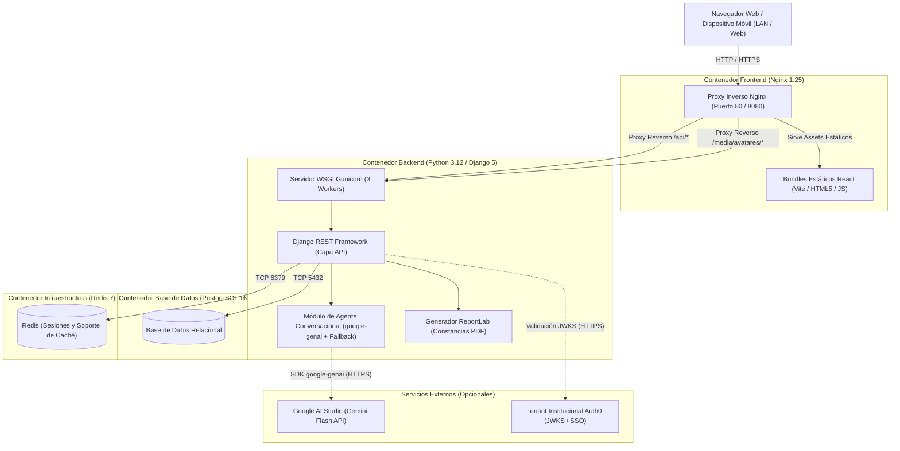
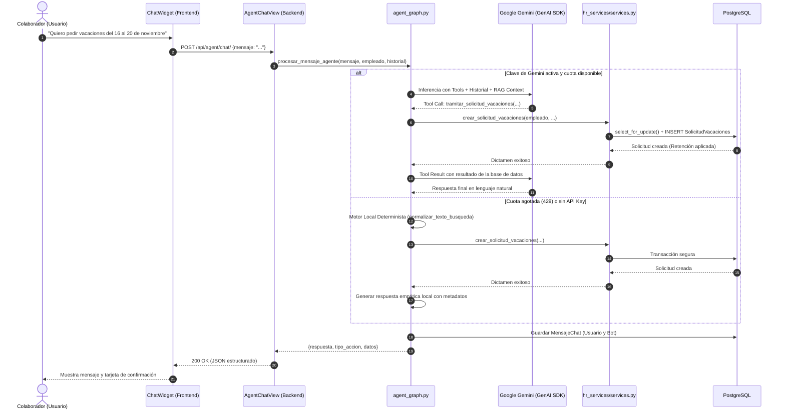
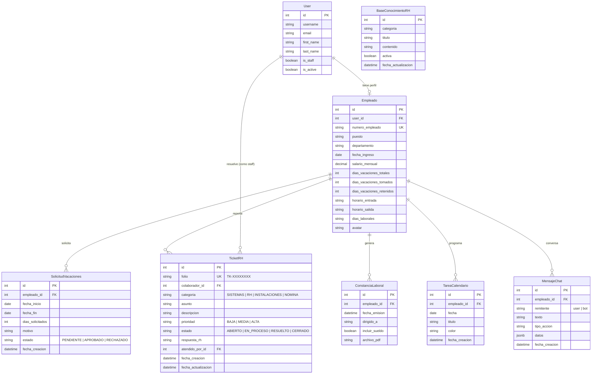
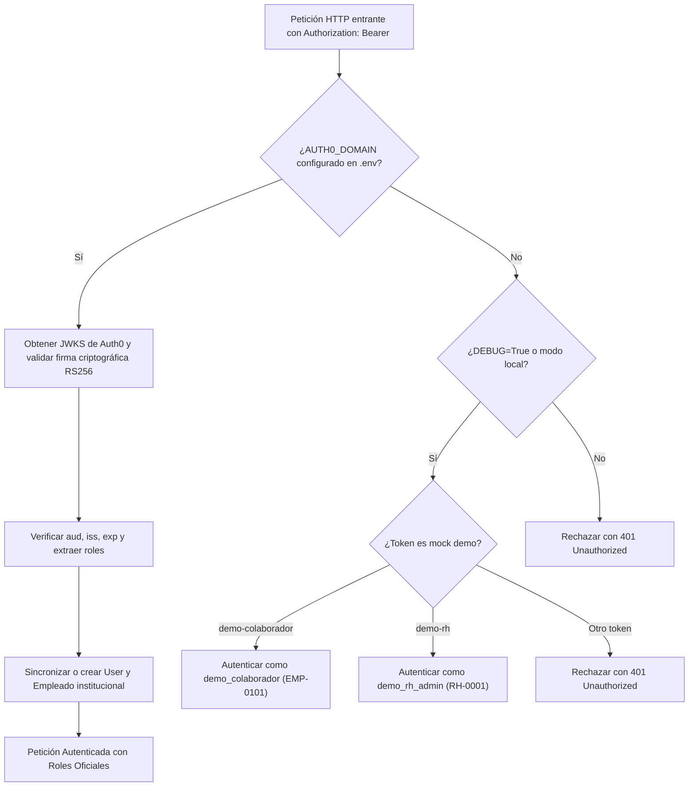

# Manual Técnico de Arquitectura, Desarrollo y Operación
## Sistema de Autoservicio para Colaboradores mediante Agentes Conversacionales
### PluriOne — Develop Talent & Technology
**Versión:** 1.0.0 (Producción / Entrega Académica)  
**Fecha:** Noviembre 2026  
**Entorno de Referencia:** Linux (Ubuntu/Debian), Docker v24+, Docker Compose v2+  

---

## Índice

1. [Introducción y Objetivos del Sistema](#1-introducción-y-objetivos-del-sistema)
2. [Arquitectura General de la Solución](#2-arquitectura-general-de-la-solución)
   - 2.1. [Topología de Microservicios y Contenedores](#21-topología-de-microservicios-y-contenedores)
   - 2.2. [Patrones de Diseño Implementados](#22-patrones-de-diseño-implementados)
3. [Módulo de Inteligencia Artificial y Agentes Conversacionales](#3-módulo-de-inteligencia-artificial-y-agentes-conversacionales)
   - 3.1. [Cascada de Modelos Gemini y Function Calling](#31-cascada-de-modelos-gemini-y-function-calling)
   - 3.2. [Motor Determinista de Respaldo Local (Offline / Fallback)](#32-motor-determinista-de-respaldo-local-offline--fallback)
   - 3.3. [Arquitectura RAG (Recuperación y Generación Aumentada)](#33-arquitectura-rag-recuperación-y-generación-aumentada)
   - 3.4. [Persistencia Cronológica y Memoria Contextual](#34-persistencia-cronológica-y-memoria-contextual)
4. [Modelo de Datos y Base de Datos Relacional](#4-modelo-de-datos-y-base-de-datos-relacional)
   - 4.1. [Diagrama Entidad-Relación (ERD)](#41-diagrama-entidad-relación-erd)
   - 4.2. [Diccionario de Tablas y Atributos](#42-diccionario-de-tablas-y-atributos)
5. [Seguridad, Control de Acceso y Concurrencia](#5-seguridad-control-de-acceso-y-concurrencia)
   - 5.1. [Autenticación Híbrida: Auth0 RS256 vs. Modo Demo Local](#51-autenticación-híbrida-auth0-rs256-vs-modo-demo-local)
   - 5.2. [Control de Acceso Basado en Roles (RBAC)](#52-control-de-acceso-basado-en-roles-rbac)
   - 5.3. [Transaccionalidad Atómica y Bloqueo Pesimista](#53-transaccionalidad-atómica-y-bloqueo-pesimista)
   - 5.4. [Mitigación de Fuga de Tokens y Protección de Documentos](#54-mitigación-de-fuga-de-tokens-y-protección-de-documentos)
6. [Catálogo de Endpoints de la API REST](#6-catálogo-de-endpoints-de-la-api-rest)
7. [Infraestructura y Despliegue con Docker](#7-infraestructura-y-despliegue-con-docker)
   - 7.1. [Ambiente de Desarrollo (`docker-compose.yml`)](#71-ambiente-de-desarrollo-docker-composeyml)
   - 7.2. [Ambiente de Producción (`docker-compose.prod.yml`)](#72-ambiente-de-producción-docker-composeprodyml)
   - 7.3. [Persistencia de Volúmenes y Montajes](#73-persistencia-de-volúmenes-y-montajes)
8. [Estrategia de Pruebas Automatizadas](#8-estrategia-de-pruebas-automatizadas)
9. [Guía de Puesta en Marcha y Solución de Problemas](#9-guía-de-puesta-en-marcha-y-solución-de-problemas)

---

## 1. Introducción y Objetivos del Sistema

El **Sistema de Autoservicio para Colaboradores mediante Agentes Conversacionales** es una plataforma corporativa desarrollada para centralizar, automatizar y asegurar las operaciones operativas de Recursos Humanos en **PluriOne (Develop Talent & Technology)**.

### Objetivos Principales
1. **Autoservicio Asistido por IA:** Proveer a los colaboradores una interfaz conversacional inteligente para tramitar vacaciones conforme a la Ley Federal del Trabajo, generar constancias laborales en PDF con firma digital, levantar tickets de soporte y consultar el reglamento interno.
2. **Respaldo Determinista Autónomo:** Garantizar la continuidad total del servicio aun ante caídas de red, cuotas agotadas de API (HTTP 429) o indisponibilidad de proveedores externos de IA, gracias a un motor heurístico y sintáctico embebido en el backend.
3. **Control Transaccional Estricto:** Evitar sobregiros de vacaciones o aprobaciones inconsistentes mediante transacciones atómicas con bloqueo a nivel de fila (`select_for_update`).
4. **Seguridad y Confidencialidad:** Proteger salarios y constancias mediante enlaces autenticados por token Bearer en memoria (sin parámetros de consulta en URL), con proxy inverso Nginx y RBAC.

---

## 2. Arquitectura General de la Solución

### 2.1. Topología de Microservicios y Contenedores

La solución se distribuye en cuatro contenedores aislados orquestados por Docker Compose:



### 2.2. Patrones de Diseño Implementados

- **Arquitectura en Capas (Layered Architecture):**
  - **Presentación:** React SPA con componentes funcionales, hooks personalizados (`useAuth`) y diseño adaptativo (*Mobile-First*).
  - **Controlador / API:** APIViews de Django REST Framework separadas por dominios (`views_colaborador.py`, `views_rh.py`).
  - **Lógica de Dominio:** Servicios desacoplados (`services.py`, `utils_laborales.py`, `utils_pdf.py`).
  - **Persistencia:** Modelos relacionales ORM de Django mapeados a PostgreSQL.
- **Fachada (Facade Pattern):** [`backend/hr_services/views.py`](file:///home/benjamin/Documentos/%20Sistema%20de%20Autoservicio%20para%20Colaboradores%20mediante%20Agentes%20Conversacionales/proyecto/backend/hr_services/views.py) re-exporta los controladores modularizados para preservar compatibilidad retroactiva con las rutas existentes.
- **Cadena de Responsabilidad (Chain of Responsibility) y Cascada (Fallback Cascade):** El asistente de IA evalúa secuencialmente los modelos de Gemini disponibles; ante fallas de cuota o indisponibilidad, transfiere el procesamiento al motor local determinista.

---

## 3. Módulo de Inteligencia Artificial y Agentes Conversacionales

### 3.1. Cascada de Modelos Gemini y Function Calling

Ubicado en [`backend/ai_agents/agent_graph.py`](file:///home/benjamin/Documentos/%20Sistema%20de%20Autoservicio%20para%20Colaboradores%20mediante%20Agentes%20Conversacionales/proyecto/backend/ai_agents/agent_graph.py), el motor utiliza el SDK oficial `google-genai` con una lista de redundancia jerarquizada:

```python
MODELOS_GEMINI = [
    'gemini-3.6-flash',
    'gemini-3.5-flash',
    'gemini-3.1-flash-lite',
    'gemini-flash-latest',
    'gemini-3.8-flash',
]
```

#### Declaración de Herramientas Operativas (*Function Calling*)
El agente tiene expuestas 4 funciones Python tipadas que el LLM puede invocar:
1. `tramitar_solicitud_vacaciones(fecha_inicio, fecha_fin, motivo)`: Valida el periodo, verifica días hábiles y retiene saldo.
2. `consultar_saldo_vacaciones()`: Consulta saldo legal, días tomados, días retenidos y días disponibles.
3. `generar_constancia_laboral_pdf(dirigido_a, incluir_sueldo)`: Emite documento oficial en formato PDF firmado digitalmente.
4. `crear_ticket_rh(categoria, asunto, descripcion, prioridad)`: Abre folio de soporte en mesa de ayuda de RH.



### 3.2. Motor Determinista de Respaldo Local (Offline / Fallback)

Si no se define `GEMINI_API_KEY` o si todos los modelos de la lista retornan errores `429 RESOURCE_EXHAUSTED`, `503 UNAVAILABLE` o `404 NOT_FOUND`, se activa el respaldo heurístico:
- **Normalización Fonética y Ortográfica:** Mediante `unicodedata.normalize('NFKD', texto)`, elimina acentos y signos diacríticos, transformando entradas como *«¿Cuántos días me quedan?»* en `cuantos dias me quedan` para coincidir con los árboles de intención.
- **Prioridad Sintáctica en Constancias:** Evalúa expresiones excluyentes (`sin sueldo`, `sin salario`, `sin percepcion`) antes de buscar la raíz `sueldo`, previniendo falsos positivos en cartas laborales.
- **Parsing Flexible de Fechas:** La utilidad `parsear_fecha_flexible` analiza fechas en formato numérico (`YYYY-MM-DD`, `DD/MM/YYYY`) y lenguaje natural (`del 15 al 20 de diciembre de 2026`).

### 3.3. Arquitectura RAG (Recuperación y Generación Aumentada)

- **Mecanismo:** Inyección Dinámica en Contexto (*In-Context Prompt Injection*).
- **Proceso:** En cada interacción, se consultan los registros activos de la tabla `BaseConocimientoRH`. Se formatean en bloques estructurados de política institucional y se concatenan en el *System Prompt* de la sesión conversacional.
- **Ventaja en MVP:** Cero latencia de reindexación; las actualizaciones hechas por el administrador de RH surten efecto en el segundo inmediato.

### 3.4. Persistencia Cronológica y Memoria Contextual

Los mensajes se almacenan en la tabla `MensajeChat`. Para la inferencia, se recuperan los últimos 10 mensajes ordenados cronológicamente (`order_by('fecha_creacion')`), permitiendo recordar datos mencionados previamente (como fechas o motivos).

---

## 4. Modelo de Datos y Base de Datos Relacional

### 4.1. Diagrama Entidad-Relación (ERD)



### 4.2. Diccionario de Tablas y Atributos

| Tabla | Propósito | Llaves Foráneas / Restricciones |
| :--- | :--- | :--- |
| `hr_services_empleado` | Expediente laboral, saldos de vacaciones y jornada | `user_id` -> `auth_user.id`, `numero_empleado` único |
| `hr_services_solicitudvacaciones` | Solicitudes de descanso del colaborador | `empleado_id` -> `Empleado.id`, `estado` indexado |
| `hr_services_ticketrh` | Mesa de ayuda y seguimiento de incidencias | `colaborador_id` -> `Empleado.id`, `folio` único indexado |
| `hr_services_constancialaboral` | Registro de cartas laborales emitidas | `empleado_id` -> `Empleado.id` |
| `hr_services_baseconocimientorh` | FAQs y políticas institucionales para RAG | `activa` booleano para filtrado en caliente |
| `hr_services_tareacalendario` | Notas y recordatorios personales en el calendario | `empleado_id` -> `Empleado.id`, filtro por `fecha` |
| `ai_agents_mensajechat` | Trazabilidad cronológica de interacción conversacional | `empleado_id` -> `Empleado.id`, orden por `fecha_creacion` |

---

## 5. Seguridad, Control de Acceso y Concurrencia

### 5.1. Autenticación Híbrida: Auth0 RS256 vs. Modo Demo Local

El sistema implementa una arquitectura de autenticación dual mediante [`backend/authentication/auth0.py`](file:///home/benjamin/Documentos/%20Sistema%20de%20Autoservicio%20para%20Colaboradores%20mediante%20Agentes%20Conversacionales/proyecto/backend/authentication/auth0.py):



### 5.2. Control de Acceso Basado en Roles (RBAC)

Se definen permisos personalizados en [`backend/authentication/permissions.py`](file:///home/benjamin/Documentos/%20Sistema%20de%20Autoservicio%20para%20Colaboradores%20mediante%20Agentes%20Conversacionales/proyecto/backend/authentication/permissions.py):
- `IsColaborador`: Permite acceso a endpoints de autoservicio (`/api/hr/perfil/`, `/api/hr/vacaciones/`, `/api/hr/constancia/`, `/api/agent/chat/`).
- `IsRecursosHumanos`: Requiere `rol == 'recursos humanos'` o `user.is_staff == True`. Permite autorizar vacaciones, responder tickets y administrar documentos RAG (`/api/hr/admin/*`).

### 5.3. Transaccionalidad Atómica y Bloqueo Pesimista

Para evitar condiciones de carrera cuando un colaborador solicita vacaciones simultáneamente (ej. desde el chat y desde el formulario web al mismo tiempo), [`backend/hr_services/services.py`](file:///home/benjamin/Documentos/%20Sistema%20de%20Autoservicio%20para%20Colaboradores%20mediante%20Agentes%20Conversacionales/proyecto/backend/hr_services/services.py) aplica:
1. `transaction.atomic()`: Bloque de transacción indivisible.
2. `Empleado.objects.select_for_update().get(pk=empleado.pk)`: Bloquea la fila del colaborador a nivel de motor PostgreSQL hasta que se verifique el saldo y se asiente la solicitud.
3. Validación de solapamiento: Bloquea solicitudes cruzadas (`fecha_inicio <= f_fin` y `fecha_fin >= f_ini`).

### 5.4. Mitigación de Fuga de Tokens y Protección de Documentos

1. **Eliminación de Tokens en Query Strings:** Se eliminó cualquier lectura de `?token=` en el backend y frontend. Las solicitudes de PDF se efectúan con `apiClient.get(..., { responseType: 'blob' })` inyectando el JWT en la cabecera HTTP `Authorization: Bearer <token>`.
2. **Protección en Nginx:** La ruta `/media/constancias/` está terminantemente bloqueada en Nginx con `403 Forbidden`. Las constancias no se sirven directamente como archivos estáticos públicos; se generan o entregan exclusivamente a través de la vista controlada `/api/hr/constancia/`.

---

## 6. Catálogo de Endpoints de la API REST

### Portal del Colaborador (Autoservicio)
| Método | Endpoint | Permiso | Descripción |
| :--- | :--- | :--- | :--- |
| `GET` | `/api/hr/perfil/` | `IsColaborador` | Retorna el perfil y balance de vacaciones del colaborador autenticado. |
| `POST` | `/api/hr/perfil/` | `IsColaborador` | Actualiza la fotografía de avatar (`multipart/form-data`). |
| `DELETE` | `/api/hr/perfil/` | `IsColaborador` | Elimina la fotografía de perfil actual. |
| `GET` | `/api/hr/vacaciones/` | `IsColaborador` | Retorna el historial de solicitudes y desglose métrico de días. |
| `POST` | `/api/hr/vacaciones/` | `IsColaborador` | Crea solicitud de vacaciones con validación de días hábiles. |
| `GET` | `/api/hr/tickets/` | `IsColaborador` | Lista los tickets de soporte levantados por el usuario. |
| `POST` | `/api/hr/tickets/` | `IsColaborador` | Crea un nuevo ticket asignando folio institucional único. |
| `GET` | `/api/hr/constancia/` | `IsColaborador` | Emite y transmite en memoria el flujo binario del PDF oficial. |
| `POST` | `/api/hr/constancia/` | `IsColaborador` | Guarda los parámetros deseados (`dirigido_a`, `incluir_sueldo`) y genera PDF. |
| `GET` | `/api/hr/calendario/` | `IsColaborador` | Consulta tareas y vacaciones registradas por fecha. |
| `POST` | `/api/hr/calendario/` | `IsColaborador` | Registra una nueva tarea personal en el calendario. |
| `DELETE` | `/api/hr/calendario/<id>/` | `IsColaborador` | Elimina una tarea del calendario. |

### Agente Conversacional
| Método | Endpoint | Permiso | Descripción |
| :--- | :--- | :--- | :--- |
| `POST` | `/api/agent/chat/` | `IsColaborador` | Procesa mensaje del usuario mediante IA o motor local de respaldo. |
| `GET` | `/api/agent/historial/`| `IsColaborador` | Recupera el historial cronológico de la conversación. |
| `DELETE`| `/api/agent/historial/`| `IsColaborador` | Reinicia y limpia la memoria del hilo conversacional. |

### Portal de Recursos Humanos (Administración)
| Método | Endpoint | Permiso | Descripción |
| :--- | :--- | :--- | :--- |
| `GET` | `/api/hr/admin/vacaciones/` | `IsRecursosHumanos` | Lista todas las solicitudes de vacaciones del personal. |
| `POST` | `/api/hr/admin/vacaciones/` | `IsRecursosHumanos` | Registra solicitud directa en nombre de un colaborador. |
| `PATCH` | `/api/hr/admin/vacaciones/<id>/` | `IsRecursosHumanos` | Aprueba o rechaza solicitud, aplicando descuento de saldo final. |
| `GET` | `/api/hr/admin/tickets/` | `IsRecursosHumanos` | Supervisión consolidada de la mesa de ayuda. |
| `PATCH` | `/api/hr/admin/tickets/<id>/` | `IsRecursosHumanos` | Dictamina ticket, emite respuesta oficial y actualiza estado. |
| `GET, POST` | `/api/hr/admin/faqs/` | `IsRecursosHumanos` | Consulta y alta de lineamientos para la base de conocimiento RAG. |
| `PATCH, DELETE` | `/api/hr/admin/faqs/<id>/` | `IsRecursosHumanos` | Alterna estado activo/inactivo o elimina lineamiento RAG. |
| `POST` | `/api/hr/admin/documentos/` | `IsRecursosHumanos` | Ingesta de archivos PDF normativos para extracción automática de texto. |

---

## 7. Infraestructura y Despliegue con Docker

### 7.1. Ambiente de Desarrollo (`docker-compose.yml`)
- Ejecución: `docker compose up --build -d`
- Backend: Servidor ligero `manage.py runserver 0.0.0.0:8000` con recarga automática en vivo (volumen `./backend:/app`).
- Frontend: Servidor de desarrollo Vite en el puerto `5173` con *Hot Module Replacement* (HMR).
- Variables: `.env.example` preconfigurado con `DEBUG=True` y variables de Auth0 comentadas para arranque inmediato.

### 7.2. Ambiente de Producción (`docker-compose.prod.yml`)
- Ejecución: `docker compose -f docker-compose.prod.yml up --build -d`
- Backend: Gunicorn WSGI con 3 workers concurrentes (`--timeout 120`).
- Frontend: Construcción multi-etapa en [`frontend/Dockerfile.prod`](file:///home/benjamin/Documentos/%20Sistema%20de%20Autoservicio%20para%20Colaboradores%20mediante%20Agentes%20Conversacionales/proyecto/frontend/Dockerfile.prod) con `nginx:alpine`.
- Puerto Externo: Mapeo configurable mediante `${FRONTEND_PORT:-80}:80`.

### 7.3. Persistencia de Volúmenes y Montajes

| Identificador | Tipo | Ruta Contenedor | Propósito |
| :--- | :--- | :--- | :--- |
| `postgres_data` | Volumen Docker | `/var/lib/postgresql/data` | Persistencia de tablas, usuarios e índices de PostgreSQL. |
| `redis_data` | Volumen Docker | `/data` | Almacenamiento y persistencia en disco de Redis. |
| `./backend/media` | Bind Mount | `/app/media` | Almacenamiento local de fotografías de perfil (`avatares/`) y constancias (`constancias/`). |

---

## 8. Estrategia de Pruebas Automatizadas

La aplicación cuenta con una suite integral de 52 pruebas automatizadas en Django que cubren:
1. **Autenticación y Tokens Mock:** Validación de tokens de prueba en modo demo y rechazo estricto en producción.
2. **Cálculo Laboral y Días Hábiles:** Exclusión de fines de semana y festivos conforme a la ley mexicana.
3. **Control de Concurrencia y Solapamiento:** Rechazo de peticiones encimadas y retención correcta de saldo.
4. **Respaldo Determinista del Agente:** Normalización de tildes en consultas de vacaciones y precedencia de *«sin sueldo»* en constancias.
5. **Generación de Constancias PDF:** Validación de estructura ReportLab y meses en español (`MESES_ESP`).

### Comando de Ejecución
```bash
docker compose exec backend python manage.py test
```

---

## 9. Guía de Puesta en Marcha y Solución de Problemas

### Puesta en marcha desde cero en 4 pasos
```bash
# 1. Clonar repositorio y posicionarse en la carpeta
git clone https://github.com/gatoAmaranto/academy-rh.git
cd academy-rh

# 2. Copiar plantilla de variables de entorno
cp .env.example .env

# 3. Levantar contenedores
docker compose up --build -d

# 4. Aplicar migraciones y poblar datos semilla
docker compose exec backend python manage.py migrate
docker compose exec backend python manage.py poblar_datos_iniciales
```

### Comandos de Diagnóstico Útiles

```bash
# Ver estado y salud de los contenedores
docker compose ps

# Monitorear logs en tiempo real
docker compose logs -f backend

# Recrear base de datos limpia de desarrollo
docker compose down -v
docker compose up -d
docker compose exec backend python manage.py migrate
docker compose exec backend python manage.py poblar_datos_iniciales
```

---
*Manual técnico elaborado y certificado para el proyecto PluriOne — UPAM BNMG-224-ACADEMIC.*
